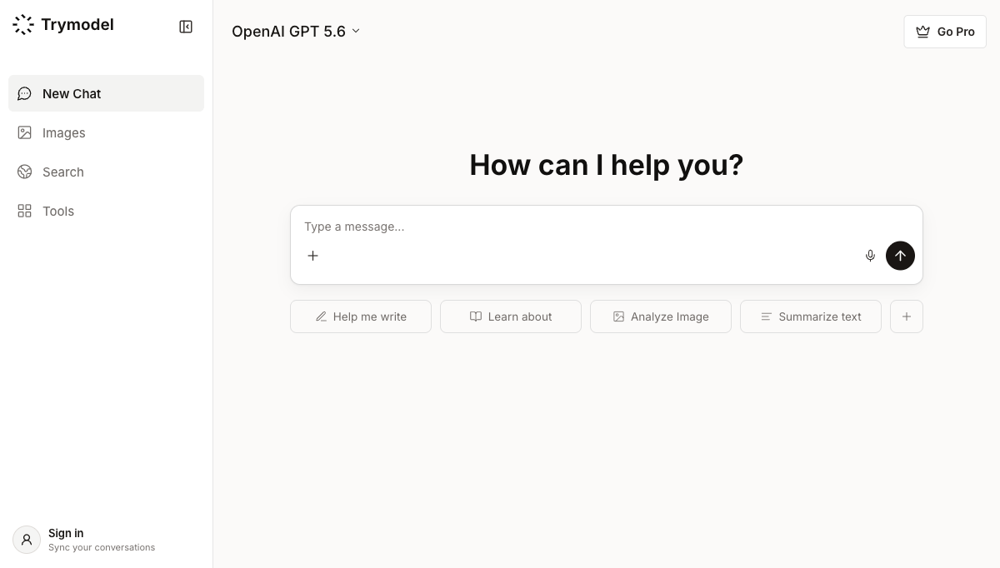
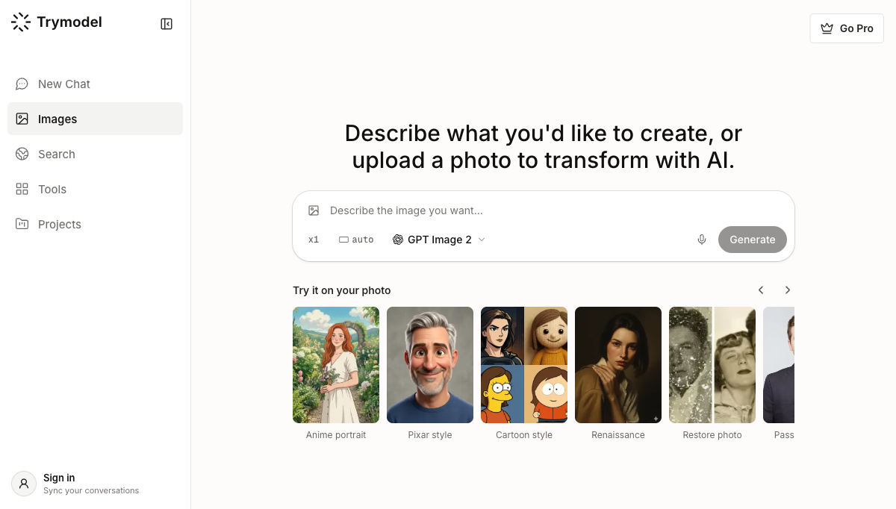
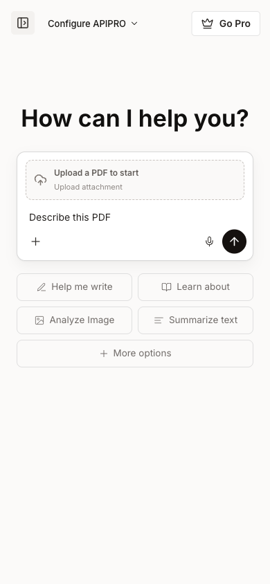
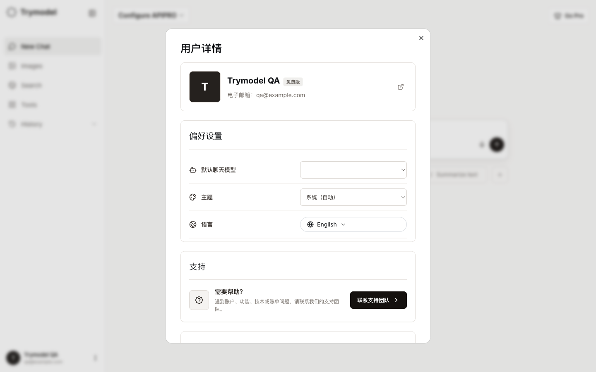
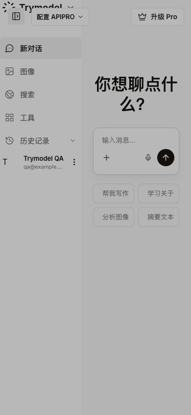
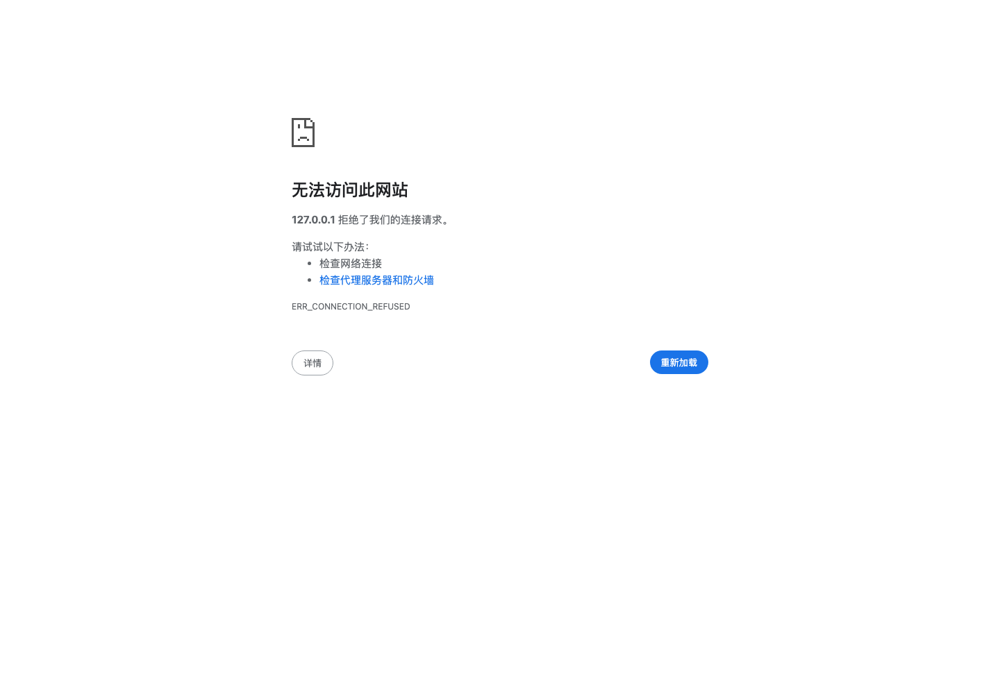

# Trymodel

Trymodel 是一个把主流 AI 模型集中到同一个工作区的 AI 应用。你可以在一个对话中切换不同模型，也可以完成图像创作、联网搜索、深度研究、文件分析和项目协作。

在线体验：<https://trymodel.chat/>

Trymodel 的目标很简单：不用在多个 AI 网站之间来回切换，用一个账号管理对话、模型、文件和工作项目。

## 产品一览

### 多模型 AI 对话

Trymodel 支持在同一个聊天界面使用 ChatGPT、Claude、Gemini、Grok、DeepSeek、Qwen、Llama、Kimi 等主流模型。模型选择器会按照当前可用的模型来源展示，管理员也可以在后台维护模型目录和 API 来源。



聊天体验包括：

- 流式输出和打字机效果
- 停止生成与继续生成
- 思考状态和响应耗时提示
- Markdown、代码和表格渲染
- 一键复制回答或代码
- 长对话导航和历史记录
- 新建对话、标题自动生成和会话恢复

### AI 图像创作

图像页面支持使用 `gpt-image-2` 等图像模型生成图片，并提供常用画布尺寸和方向选择。适合海报、封面、社交媒体配图、产品概念图和视觉草稿等场景。



常用尺寸包括：

- 1024 × 1024：正方形
- 1536 × 1024：横版
- 1024 × 1536：竖版
- 2048 × 2048：2K 正方形
- 2048 × 1152：2K 横版
- 3840 × 2160：4K 横版
- 2160 × 3840：4K 竖版
- `auto`：由模型自动选择

### 联网搜索与深度研究

需要最新信息时，可以在聊天中开启联网搜索。Trymodel 会调用搜索服务获取网页信息，再交给模型整理为带有来源上下文的回答。

适用场景包括：

- 查询新闻、产品规格和软件更新
- 汇总多个网页中的资料
- 对比模型、工具和方案
- 生成研究提纲、竞品分析和资料摘要

### Projects 项目工作区

Projects 用于管理长期任务。每个项目可以保存项目说明、默认模型、智能体和知识库，让后续对话自动带上稳定的上下文。

适合这些工作：

- 产品研发和需求梳理
- 代码项目问答
- 内容选题与文章写作
- 运营资料和品牌知识管理
- 团队内部的固定工作流

项目聊天在项目内部完成，不需要反复跳回普通聊天页。

### 文件与文档处理

Trymodel 支持粘贴或上传图片、PDF、Word、Excel 等附件，让模型直接阅读和分析文件内容。



典型用法：

- 总结 PDF、Word 文档
- 提取表格数据并解释 Excel 内容
- 根据文件生成报告、邮件或 Markdown 文章
- 识别代码和 HTML，并进行在线运行或重写
- 从图片中提取文字、结构和关键信息

### 历史记录与账户

对话会按用户保存，支持最近对话查看、恢复和管理。账户设置可以维护头像、显示名称、语言和其他个人偏好。



Trymodel 提供中文和英文界面，并针对桌面端和移动端做了响应式适配。



### 内容中心

Trymodel 还提供产品中心和博客内容，用于介绍 AI 模型、使用方法和实际工作流。用户可以从文章进入对应功能，再回到聊天工作区继续操作。



## 适合谁使用

- **开发者**：比较不同模型的代码能力，分析项目文件，快速验证方案。
- **内容创作者**：写文章、改写文案、生成图片和整理选题资料。
- **研究人员**：联网搜索、汇总来源、构建研究提纲和对比报告。
- **产品与运营团队**：在 Projects 中沉淀固定提示词、知识库和协作流程。
- **普通用户**：用一个入口完成问答、翻译、总结、写作和创意生成。

## 安全与管理

Trymodel 使用 Better Auth 处理账户登录，支持邮箱密码和 OAuth 登录方式。后台提供 RBAC 权限管理、模型/API 来源管理、用户聊天记录、额度管理和内容管理。

针对批量注册和滥用风险，系统支持：

- 注册接口按 IP 限流
- 常见一次性邮箱域名拦截
- 按注册 IP、邮箱域名、邮箱验证状态生成风险依据
- 后台按风险筛选账号
- 批量封禁和解封账号

## 技术架构

- TanStack Start、TanStack Router、React 19、TypeScript
- Vite 与 Nitro Cloudflare preset
- Drizzle ORM
- Cloudflare Workers + D1
- Better Auth
- Tailwind CSS 与 shadcn/ui
- Paraglide JS 国际化
- Stripe 支付与订阅能力

项目的生产环境运行在 Cloudflare Workers，D1 用于保存账户、对话、项目、知识库和业务数据。

## 本地运行

```bash
pnpm install
cp .env.example .env.development
pnpm db:push
pnpm dev
```

启动后访问：<http://localhost:3000>

生产构建：

```bash
pnpm cf:build
```

Cloudflare 部署：

```bash
pnpm cf:deploy
```

所有密钥和 API 凭据都应通过本地环境变量或 Cloudflare Secret 配置，不要提交到 Git 仓库。

## 项目链接

- 产品网站：<https://trymodel.chat/>
- 产品中心：<https://trymodel.chat/hub>
- GitHub：<https://github.com/xianyu110/chatday-tanstack>

## 许可证

本项目当前为私有项目。未经授权，不得复制、再分发或用于商业部署。
